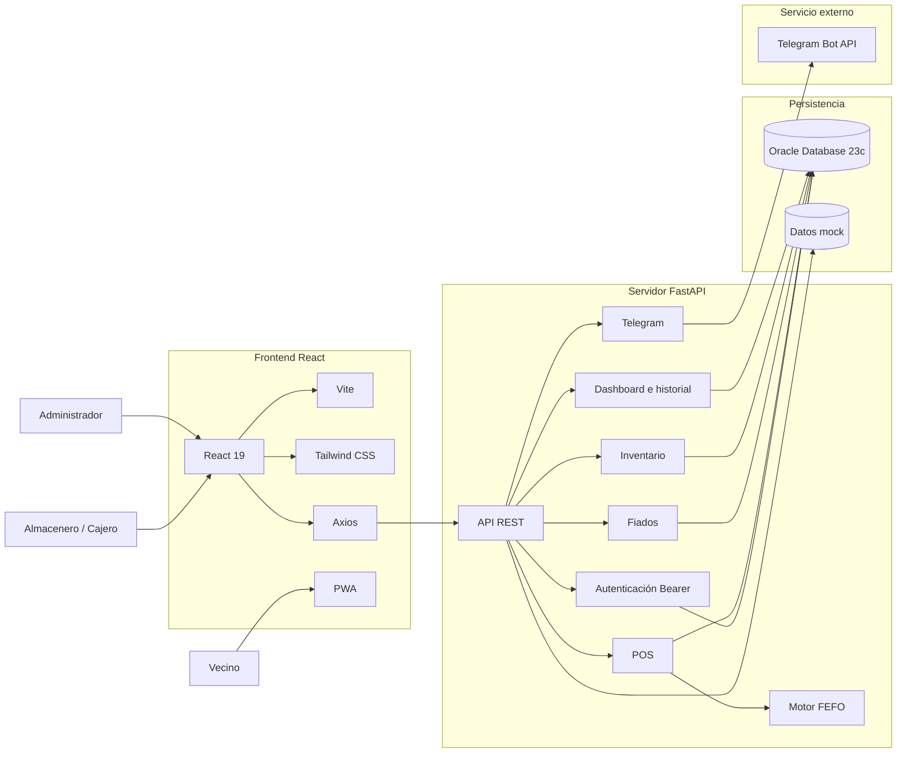
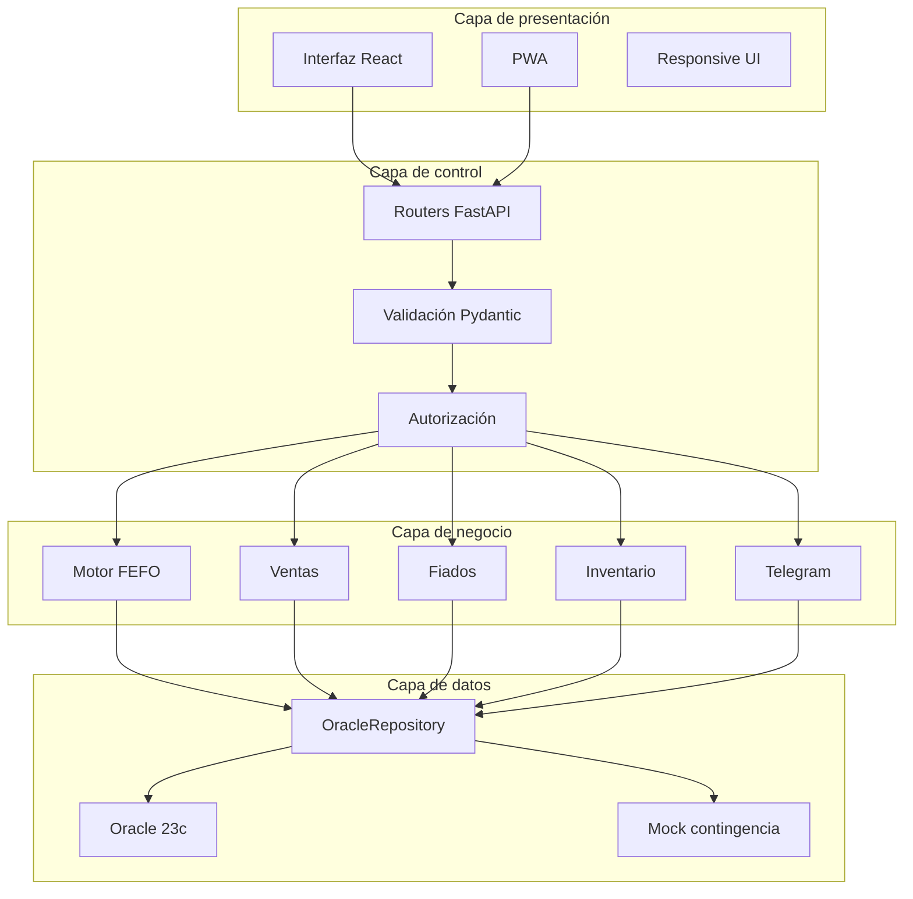
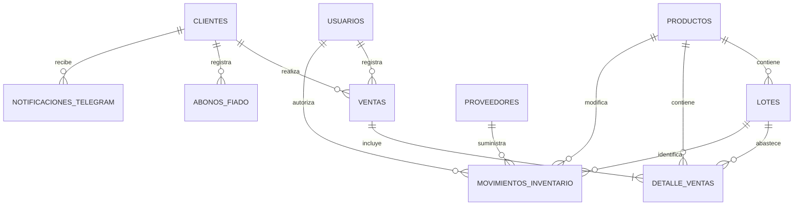
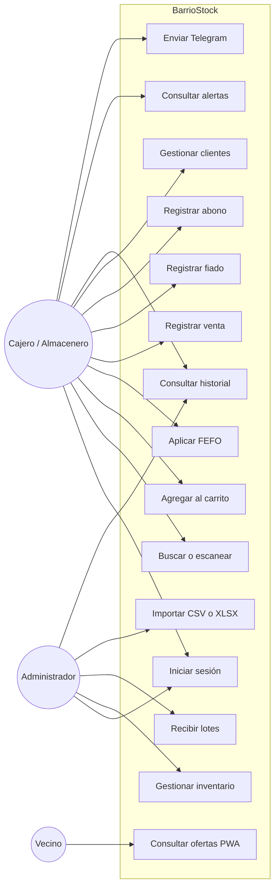
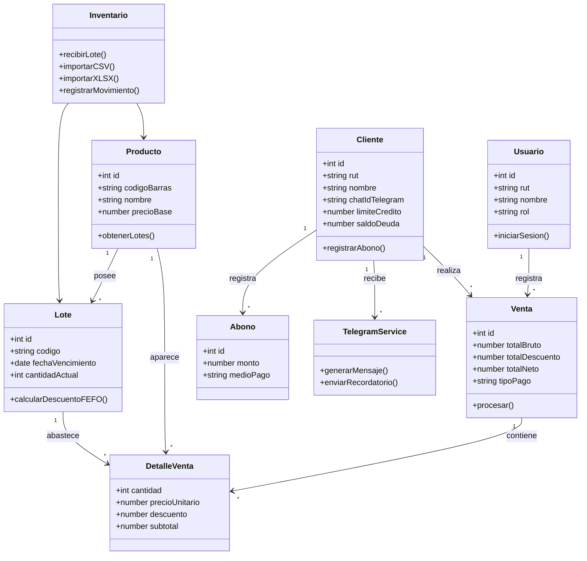
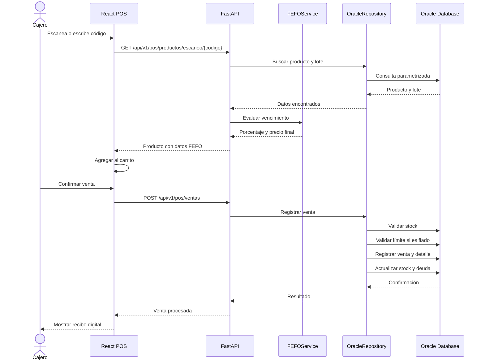
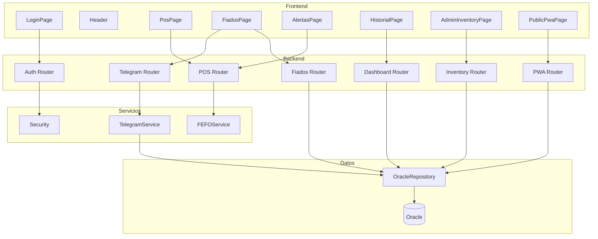
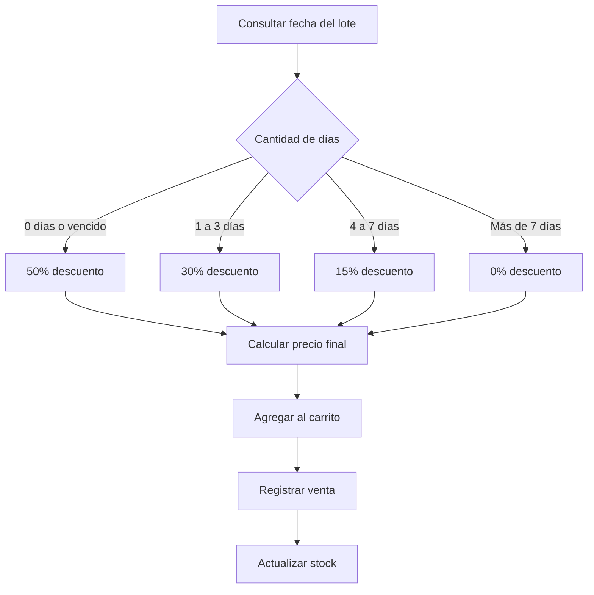
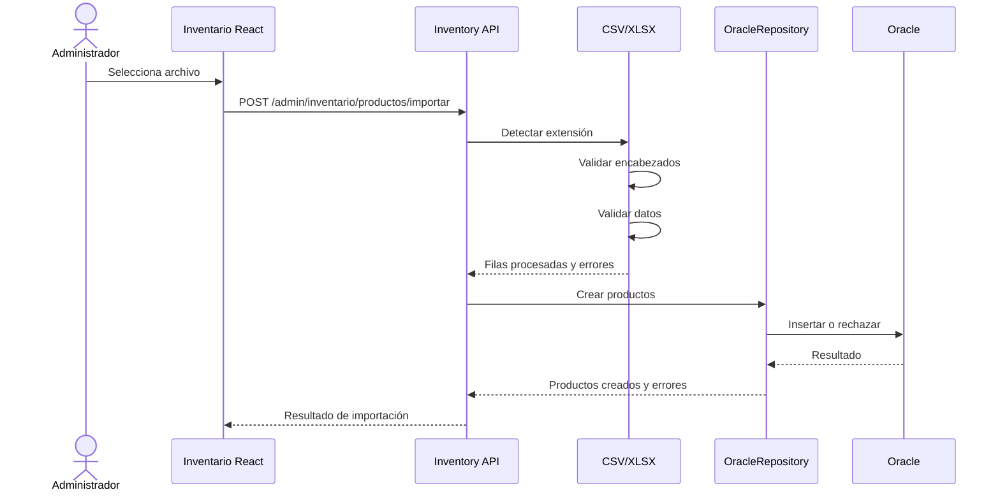
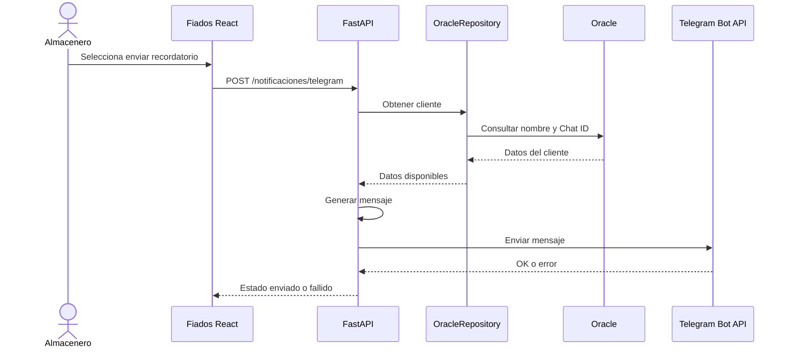

## Documento de Diseño: Arquitectura, modelo de datos y diagramas UML


# 1. Resumen ejecutivo

BarrioStock es una plataforma web diseñada para almacenes de barrio. Integra:

- Punto de venta.
- Administración de inventario.
- Recepción de lotes.
- Motor FEFO.
- Ventas en efectivo, tarjeta y fiado.
- Registro de abonos.
- Historial de operaciones.
- Catálogo público PWA.
- Notificaciones mediante Telegram.
- Base de datos Oracle Database 23c.
- Contenedores Docker.

La arquitectura está separada en frontend, API REST, servicios de negocio y persistencia.

---

# 2. Arquitectura general




# 3. Componentes del frontend

## Tecnologías

- React 19.
- Vite.
- TailwindCSS.
- Axios.
- PWA.
- Lucide React.
- QRCode React.

## Principales componentes

| Componente | Responsabilidad |
|---|---|
| `App.jsx` | Sesión, navegación y estado global |
| `Header.jsx` | Navegación, usuario y menú responsive |
| `LoginPage.jsx` | Inicio de sesión |
| `PosPage.jsx` | Escaneo, carrito y pagos |
| `FiadosPage.jsx` | Clientes, abonos y Telegram |
| `AlertasPage.jsx` | Productos próximos a vencer |
| `HistorialPage.jsx` | Ventas e productos destacados |
| `AdminInventoryPage.jsx` | Productos, proveedores e inventario |
| `PublicPwaPage.jsx` | Catálogo público |
| `NuevoClienteModal.jsx` | Creación de clientes |
| `AbonoModal.jsx` | Registro de abonos |
| `EditarClienteModal.jsx` | Edición de clientes |
| `QrPwaModal.jsx` | Presentación del enlace QR |
| `api.js` | Cliente HTTP y autenticación |

## Interacción frontend/API

1. React inicia sesión mediante Axios.
2. El backend entrega el token Bearer.
3. React guarda el token en `localStorage`.
4. Las solicitudes protegidas incluyen el token.
5. FastAPI valida permisos y devuelve JSON.
6. React actualiza el estado local o la vista.
7. El catálogo público no requiere autenticación.

---

# 4. Componentes del backend

## Tecnologías

- Python 3.11 o superior.
- FastAPI.
- Pydantic.
- Uvicorn.
- python-multipart.
- oracledb.
- httpx.

## Estructura funcional

```text
backend/app
├── api/v1
│   ├── auth.py
│   ├── pos.py
│   ├── fiados.py
│   ├── inventory.py
│   ├── dashboard.py
│   ├── notificaciones.py
│   └── pwa.py
├── core
│   ├── config.py
│   ├── database.py
│   └── security.py
├── repositories
│   └── oracle_repository.py
├── services
│   ├── fefo_service.py
│   └── telegram_service.py
└── schemas
```

## Responsabilidades

| Componente | Responsabilidad |
|---|---|
| Routers | Exponen endpoints REST |
| Pydantic | Valida entradas y respuestas |
| Seguridad | Genera y valida tokens |
| FEFO | Calcula descuentos por vencimiento |
| Telegram | Envía recordatorios |
| Repositorio | Consulta Oracle y mock |
| Dependencias | Valida autenticación y rol |

---

# 5. Arquitectura por capas



# 6. Modelo entidad-relación




# 7. Modelo relacional

## USUARIOS

| Campo | Tipo | Restricción |
|---|---|---|
| id | NUMBER | Clave primaria |
| rut | VARCHAR2(12) | Único, obligatorio |
| nombre | VARCHAR2(100) | Obligatorio |
| rol | VARCHAR2(20) | ADMIN o CAJERO |
| password_hash | VARCHAR2(255) | Obligatorio |
| creado_en | TIMESTAMP | Por defecto |

## CLIENTES

| Campo | Tipo | Restricción |
|---|---|---|
| id | NUMBER | Clave primaria |
| rut | VARCHAR2(12) | Único |
| nombre | VARCHAR2(100) | Obligatorio |
| telefono | VARCHAR2(64) | Chat ID Telegram |
| limite_credito | NUMBER(10,0) | Mayor o igual a cero |
| saldo_deuda | NUMBER(10,0) | Mayor o igual a cero |
| creado_en | TIMESTAMP | Por defecto |

> Conviene renombrar `telefono` a `chat_id_telegram` en una actualización del esquema.

## PRODUCTOS

| Campo | Tipo | Restricción |
|---|---|---|
| id | NUMBER | Clave primaria |
| codigo_barras | VARCHAR2(50) | Único |
| nombre | VARCHAR2(100) | Obligatorio |
| categoria | VARCHAR2(50) | Obligatorio |
| precio_base | NUMBER(10,0) | Mayor que cero |
| unidad_medida | VARCHAR2(20) | Por defecto UNIDAD |
| stock_minimo | NUMBER(8,0) | Mayor o igual a cero |
| controla_vencimiento | NUMBER(1,0) | Booleano |
| activo | NUMBER(1,0) | Booleano |

## LOTES

| Campo | Tipo | Restricción |
|---|---|---|
| id | NUMBER | Clave primaria |
| producto_id | NUMBER | Clave foránea |
| codigo_lote | VARCHAR2(50) | Obligatorio |
| fecha_vencimiento | DATE | Obligatorio |
| cantidad_inicial | NUMBER(8,0) | Mayor que cero |
| cantidad_actual | NUMBER(8,0) | Mayor o igual a cero |
| porcentaje_descuento_fefo | NUMBER(3,0) | Por defecto cero |

## PROVEEDORES

| Campo | Tipo | Restricción |
|---|---|---|
| id | NUMBER | Clave primaria |
| nombre | VARCHAR2(120) | Único |
| activo | NUMBER(1,0) | Booleano |

## MOVIMIENTOS_INVENTARIO

| Campo | Tipo | Restricción |
|---|---|---|
| id | NUMBER | Clave primaria |
| producto_id | NUMBER | Clave foránea |
| lote_id | NUMBER | Clave foránea opcional |
| tipo_movimiento | VARCHAR2(20) | COMPRA, VENTA o AJUSTE |
| cantidad | NUMBER(8,0) | Obligatorio |
| motivo | VARCHAR2(200) | Opcional |
| usuario_id | NUMBER | Clave foránea |
| fecha_movimiento | TIMESTAMP | Por defecto |

## VENTAS

| Campo | Tipo | Restricción |
|---|---|---|
| id | NUMBER | Clave primaria |
| usuario_id | NUMBER | Clave foránea |
| cliente_id | NUMBER | Clave foránea opcional |
| fecha_venta | TIMESTAMP | Por defecto |
| total_bruto | NUMBER(10,0) | Obligatorio |
| total_descuento | NUMBER(10,0) | Por defecto cero |
| total_neto | NUMBER(10,0) | Obligatorio |
| tipo_pago | VARCHAR2(20) | EFECTIVO, TARJETA o FIADO |

## DETALLE_VENTAS

| Campo | Tipo | Restricción |
|---|---|---|
| id | NUMBER | Clave primaria |
| venta_id | NUMBER | Clave foránea |
| producto_id | NUMBER | Clave foránea |
| lote_id | NUMBER | Clave foránea |
| cantidad | NUMBER(8,0) | Mayor que cero |
| precio_unitario | NUMBER(10,0) | Mayor o igual a cero |
| descuento_aplicado | NUMBER(10,0) | Mayor o igual a cero |
| subtotal | NUMBER(10,0) | Obligatorio |

## ABONOS_FIADO

| Campo | Tipo | Restricción |
|---|---|---|
| id | NUMBER | Clave primaria |
| cliente_id | NUMBER | Clave foránea |
| monto_abonado | NUMBER(10,0) | Mayor que cero |
| fecha_abono | TIMESTAMP | Por defecto |
| medio_pago | VARCHAR2(20) | EFECTIVO, TARJETA o TRANSFERENCIA |

## NOTIFICACIONES_TELEGRAM

La implementación actual utiliza el nombre histórico `notificaciones_wa` en SQL. Se recomienda corregirlo a:

| Campo | Tipo | Restricción |
|---|---|---|
| id | NUMBER | Clave primaria |
| cliente_id | NUMBER | Clave foránea |
| chat_id_destino | VARCHAR2(64) | Obligatorio |
| mensaje | VARCHAR2(500) | Obligatorio |
| estado | VARCHAR2(20) | PENDIENTE, ENVIADO o FALLIDO |
| proveedor | VARCHAR2(30) | TELEGRAM_BOT_API o TELEGRAM_BOT_SANDBOX |
| fecha_envio | TIMESTAMP | Por defecto |

---

# 8. Diagrama UML de casos de uso




---

# 9. Diagrama UML de clases



---

# 10. Diagrama UML de secuencia

## Funcionalidad principal: venta FEFO



---

# 11. Diagrama de componentes



---

# 12. Flujo FEFO



---

# 13. Flujo de importación de inventario



---

# 14. Flujo de Telegram



---

# 15. Requisitos no funcionales

## Seguridad

- Contraseñas mediante PBKDF2.
- Tokens Bearer.
- RUT validado con dígito verificador.
- Consultas Oracle con parámetros.
- Rutas administrativas protegidas por rol.
- CORS limitado al dominio autorizado.
- Variables sensibles fuera del repositorio.
- Mensajes de error sin detalles internos.

## Rendimiento

- Índice optimizado para FEFO.
- Consultas específicas por código de barras.
- Archivos PWA precacheados.
- Build de frontend optimizado.
- API REST ligera.

## Usabilidad

- Diseño responsive.
- Menús adaptados a celular.
- Mensajes en español.
- Formularios con validaciones visibles.
- Modales de confirmación.
- Navegación simple.

## Disponibilidad

- Docker Compose.
- Health checks.
- Contenedor backend independiente.
- Fallback mock en ausencia de Oracle.
- Manejo de errores HTTP.

## Portabilidad

- Docker.
- `.env.example`.
- Scripts SQL independientes.
- Frontend configurable mediante `VITE_API_URL`.
- Backend configurable mediante variables.

## Escalabilidad

- Frontend separado del backend.
- Servicios REST.
- Repositorio único de acceso a datos.
- Servicios independientes en Railway.
- Posibilidad de incorporar caché y balanceador.

## Mantenibilidad

- Separación por módulos.
- Validaciones Pydantic.
- Servicios de negocio independientes.
- Pruebas unitarias.
- Pruebas de integración.
- Contrato API documentado.

## Interoperabilidad

- JSON sobre HTTPS.
- Axios para comunicación.
- Telegram Bot API.
- Oracle mediante oracledb.
- Nginx para archivos estáticos.

---

# 16. Docker

## Docker Compose

```yaml
services:
  oracle-db:
    build: ./database
    ports:
      - "${ORACLE_PORT}:1521"
    volumes:
      - oracle_data:/opt/oracle/oradata
    environment:
      ORACLE_PASSWORD: ${ORACLE_PASSWORD}
      ORACLE_PDB: ${DB_SERVICE}

  backend:
    build: ./backend
    ports:
      - "${BACKEND_PORT}:8000"
    environment:
      DB_HOST: oracle-db
      DB_PORT: 1521
      DB_USER: ${DB_USER}
      DB_PASSWORD: ${DB_PASSWORD}
      DB_SERVICE: ${DB_SERVICE}
      SECRET_KEY: ${SECRET_KEY}
      CORS_ORIGINS: ${CORS_ORIGINS}
      TELEGRAM_BOT_TOKEN: ${TELEGRAM_BOT_TOKEN}
      TELEGRAM_DEFAULT_CHAT_ID: ${TELEGRAM_DEFAULT_CHAT_ID}

  frontend:
    build: ./frontend
    ports:
      - "${FRONTEND_PORT}:80"
    environment:
      VITE_API_URL: ${VITE_API_URL}

volumes:
  oracle_data:
```

## Dockerfiles

### Backend

Responsable de instalar Python, abrir el puerto 8000 y ejecutar Uvicorn.

### Frontend

Responsable de:

1. Instalar dependencias.
2. Ejecutar `npm run build`.
3. Generar PWA.
4. Servir los archivos mediante Nginx.

### Oracle

Responsable de iniciar Oracle 23c Free y ejecutar scripts SQL.

## Variables obligatorias

- PROJECT_NAME.
- SECRET_KEY.
- CORS_ORIGINS.
- API_V1_STR.
- DB_HOST.
- DB_PORT.
- DB_USER.
- DB_PASSWORD.
- DB_SERVICE.
- ORACLE_PASSWORD.
- ORACLE_PORT.
- BACKEND_PORT.
- FRONTEND_PORT.
- VITE_API_URL.
- TELEGRAM_BOT_TOKEN.
- TELEGRAM_DEFAULT_CHAT_ID.

## Levantar el sistema

```powershell
docker compose up -d --build
```

## Detener el sistema

```powershell
docker compose down
```

---

# 17. Pruebas

## Backend

- Pruebas FEFO.
- Pruebas de autenticación.
- Pruebas de permisos.
- Pruebas de inventario.
- Pruebas CSV.
- Pruebas `.xlsx`.
- Pruebas de fiados.
- Pruebas de ventas.
- Pruebas de Telegram.
- Pruebas de seguridad.

Resultado confirmado:

```text
77 pruebas backend aprobadas
```

## Frontend

- Validación RUT.
- Login.
- Header responsive.
- Modales.
- Clientes.
- Abonos.
- Navegación por roles.

Resultado confirmado:

```text
41 pruebas frontend aprobadas
```

## Construcción

```text
Build de producción aprobado
Lint aprobado
PWA generada
```

---

# 18. Innovación

## Problema resuelto

BarrioStock reduce pérdidas por vencimiento y desorganización de ventas fiadas.

## Diferenciación

- FEFO integrado al POS.
- Inventario por lotes.
- Fiado digital.
- PWA pública.
- Telegram.
- Docker.
- Oracle.
- Validaciones en español.

## Valor agregado

### Económico

- Reduce merma.
- Mejora rotación.
- Controla deuda.
- Evita errores manuales.

### Social

- Reduce desperdicio.
- Facilita el acceso a ofertas.
- Moderniza almacenes pequeños.

### Técnico

- Arquitectura modular.
- Persistencia relacional.
- API REST.
- Pruebas automatizadas.
- Contenedores reproducibles.

---